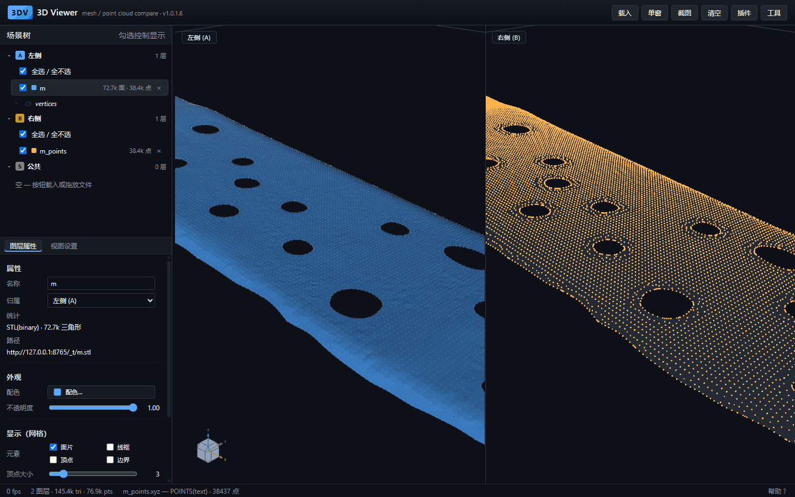
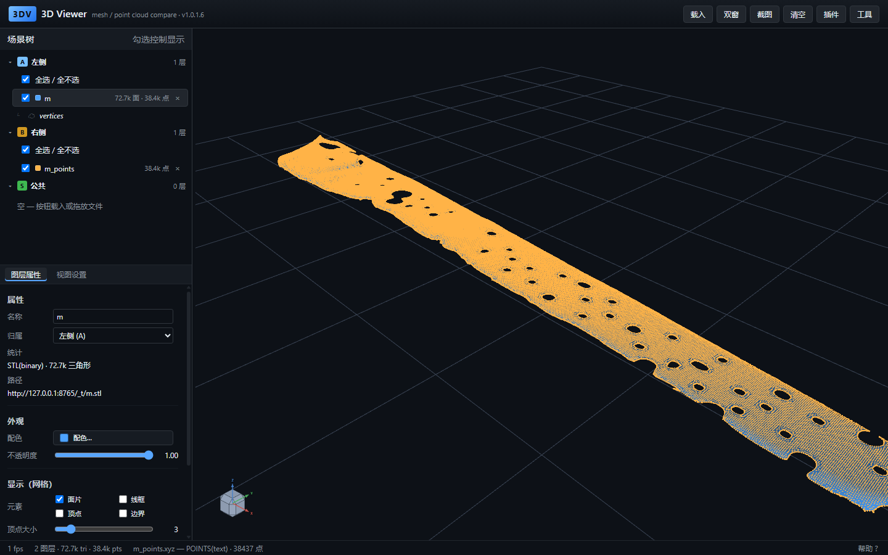
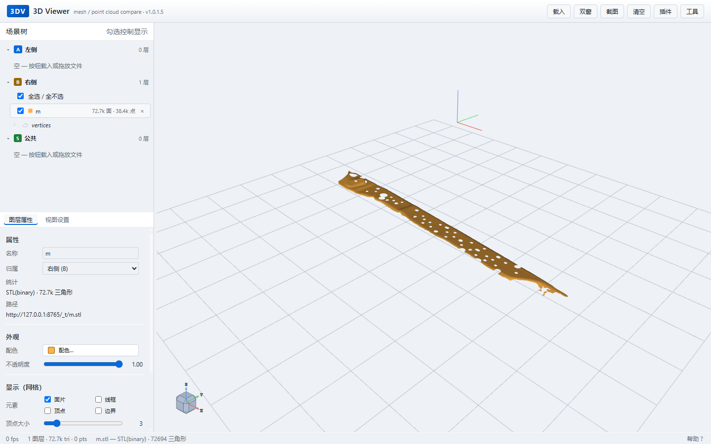
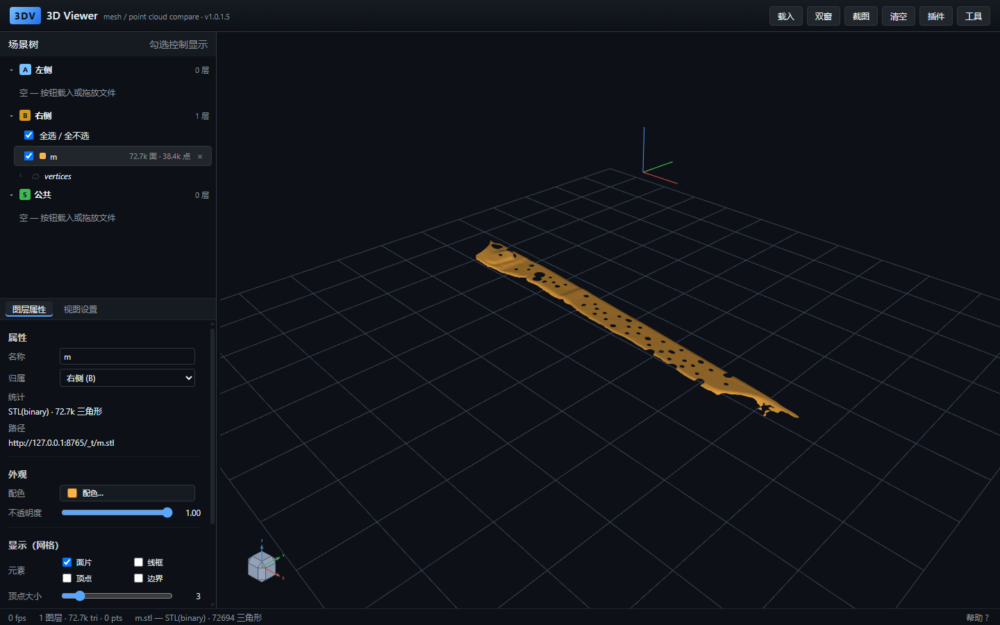

# 3D Viewer

> 零依赖的 WebGL2 三维查看器，用于网格与点云的双窗并排对比。无需构建，开箱即用。



纯原生 JavaScript + WebGL2 实现，没有框架、没有打包步骤、没有 npm 依赖。双击 `serve.bat` 即可在浏览器中打开。

---

## 核心：两份数据并排对比

这是工具的出发点——**左窗放一份、右窗放一份，同屏对照**。

上图左窗是网格（7.3 万面，蓝），右窗是同一工件的点云（3.8 万点，橙）。两侧相机同步，孔洞位置可直接横向对齐；放大到孔口级，两者的表示差异一目了然——**网格是连续的面，点云是离散的点阵**，右边孔壁边缘由点排成锯齿状。

能对比的组合不限于网格与点云：

| 左窗 | 右窗 | 典型用途 |
|---|---|---|
| 网格 | 点云 | 扫描结果 vs CAD 模型，判断偏差 |
| 网格 | 网格 | 优化前后两版结果 |
| 点云 | 点云 | 两次扫描的形变 |
| 任意 | 任意 | 两个工件的并列查看 |

两侧视口可以**独立相机**（各转各的），也可以**同步相机**（严格同角度），还可以把一侧作为半透明叠加层投到另一侧。

### 另一种对比方式：同屏叠加



单窗口内把两份数据叠在一起，适合验收“点云是否贴合模型表面”——蓝色网格的孔壁、橙色点云的分布，一屏内同时可见。

**用 URL 直接复现这两种布局**：

```
# 双窗并排，且相机同步
index.html?sync=1&url=model.stl&slot=A&url2=model_points.xyz&slot2=B

# 同屏叠加（单窗）
index.html?single=1&url=model.stl&slot=A&url2=model_points.xyz&slot2=B
```

| 参数 | 说明 |
|---|---|
| `url` / `slot` | 第一个文件与槽位（`A` 左 / `B` 右 / `BOTH` 两侧） |
| `url2` / `slot2` | 第二个文件与槽位，两个文件**串行加载**，互不覆盖 |
| `single` | `1` = 单窗口（所有图层在同一视口） |
| `sync` | `1` = 双窗共享相机，左右严格同角度 |
| `zoom` | 相机距离倍数，`< 1` 为放大，用于看局部细节 |
| `target` | `x,y,z`，镜头对准的坐标，配合 `zoom` 定点放大 |

---

## 特性

| | |
|---|---|
| **双窗并排** | 左右两个独立视口各放一份数据，相机可独立或同步；支持把一侧作半透明叠加层投到另一侧 |
| **多格式** | STL（binary / ASCII）、OBJ、PLY、点云文本（xyz / csv / txt） |
| **三维裁剪** | 矩形 / 多边形框选，空格连续追加选区，一次拆成「选中」与「剩余」两个图层 |
| **孔径测量** | 点击拾取点位，实时计算两点距离 |
| **孔位优化** | 可选插件，调用本地 `HoleOptimize_cli.exe` 计算最优孔位，结果作为子图层回填 |
| **标量场着色** | 点云按字段着色，带色标条与分布直方图 |
| **深浅主题** | 深色 / 浅色一键切换，画布、网格线、浮层同步 |



---

## 快速开始

### Windows

```bat
双击 serve.bat
```

浏览器自动打开 `http://127.0.0.1:8765/`。

### 手动启动

```bash
python server/serve.py
```

可选环境变量：

| 变量 | 默认 | 说明 |
|---|---|---|
| `VIEWER_PORT` | `8765` | 本地服务端口 |
| `VIEWER_NOBROWSER` | — | 设为 `1` 则不自动打开浏览器 |

### 加载数据

三种方式任选：

1. 顶栏 **载入** → 选择文件
2. 把文件**拖到窗口**里
3. URL 直达：`index.html?url=<相对路径>&slot=B`

---

## 支持格式

| 类型 | 扩展名 | 说明 |
|---|---|---|
| 三角网格 | `.stl` | binary / ASCII；STL 无共享顶点信息，加载时按坐标去重（约省 80% 顶点） |
| 三角网格 | `.obj` | 保留原始 `v` / `f` 拓扑，不做顶点合并 |
| 三角网格 | `.ply` | ASCII / binary |
| 点云 | `.xyz` `.csv` `.txt` | 空白或逗号分隔，支持额外标量列 |

超过内存预算时会在加载前弹窗确认，可选择按比例下采样。

---

## 界面

```
┌──────────────────────────────────────────────────────────┐
│ 3DV  3D Viewer                        载入 双窗 截图 清空  │
├────────────┬─────────────────────────────────────────────┤
│ 场景树      │                                             │
│  A 左侧     │                                             │
│  B 右侧     │              视口（单窗 / 双窗）             │
│  S 公共     │                                             │
├────────────┤                                             │
│ 图层属性    │                                             │
│ 视图设置    │                                             │
└────────────┴─────────────────────────────────────────────┘
```

**槽位含义**：`A` 左侧、`B` 右侧、`S` 公共（两侧同时显示）。图层可在槽位间移动或拷贝，移动后可作为对面模型的半透明叠加层（ghost）。

**场景树**：支持父子层级。网格加载后显示 `72.7k 面 · 38.4k 点`；选中网格后其下方出现 `vertices` 子项，点击查看顶点数与包围盒，右键可把顶点拷成点云图层。

**侧栏**：可左右拖拽调宽（220~620px）；场景树与下方属性区之间可上下拖拽，各自独立滚动。

单窗模式下的完整界面：



---

## 常用操作

### 鼠标

| 操作 | 功能 |
|---|---|
| 左键拖拽 | 旋转 |
| 中键 / 右键拖拽 | 平移 |
| 滚轮 | 缩放 |
| `Ctrl` + 左键 | 点击模型表面设为旋转中心 |
| 单击图层 | 选中，属性面板显示详情 |
| 双击图层 | 视角聚焦到该图层 |

### 键盘

| 按键 | 功能 |
|---|---|
| `f` | 视角适应全部 |
| `w` | 切换选中网格的线框 |
| `n` | 切换法向显示 |
| `p` | 显示 / 隐藏拾取信息 |
| `Delete` | 删除选中图层 |
| `空格` | 裁剪模式下：保留当前高亮，继续框选下一块 |
| `Ctrl` + `Z` | 撤销上一次追加的选区 |
| `Esc` | 退出裁剪 / 取消当前操作 |

### 三维裁剪流程

```
工具 ▾ → 裁剪
   ↓
框选（矩形 / 多边形）→ 高亮显示选中部分
   ↓
空格 或「继续裁剪」→ 保留高亮，追加下一块（可重复）
   ↓
应用裁剪 → 拆成 _segmented / _remaining 两个图层，退出裁剪
```

裁剪产生的两个图层是完整的几何体，可继续参与后续裁剪或优化。

---

## 孔位优化（可选）

需要本地编译好的 `HoleOptimize_cli.exe`。插件通过 `POST /optimize` 调用它，结果作为子图层挂到源网格下。

`server/bridge.py` 按以下顺序定位 exe：

1. 环境变量 `HOLEOPT_EXE`
2. `<项目根>/HoleOptimize/build/Release/HoleOptimize_cli.exe`
3. `<项目根>/HoleOptimize/build/Debug/HoleOptimize_cli.exe`

自检：

```bash
curl http://127.0.0.1:8765/health
```

返回中的 `exe` 与 `exists` 会明确告诉你 exe 在哪、是否存在。

没有该 exe 时，其余功能不受影响。

---

## 大文件与内存

加载前按文件大小预估内存占用，超出预算会弹窗：

| 选项 | 行为 |
|---|---|
| 取消 | 不加载 |
| 下采样 | 按比例抽样三角形 / 点，并在状态栏标注“已抽样” |
| 强制加载 | 忽略预算（显存不足时 GL 会拒绝并给出提示） |

调试参数：`?memlimit=<MB>`、`?maxpts=<N>`、`?maxtri=<N>`。

---

## 目录结构

```
3DViewer/
├── index.html            单页入口
├── serve.bat             一键启动（静态服务 + 优化桥接）
├── check.ps1             冒烟测试（7 个场景）
├── css/style.css         深浅两套主题变量
├── js/
│   ├── core.js           数学：向量、矩阵、四元数、包围盒
│   ├── io.js             STL / OBJ / PLY / 点云解析
│   ├── algo.js           三角求交、拾取、裁剪、空间索引
│   ├── render.js         WebGL2 渲染、分块、视角器
│   ├── ui.js             场景树、属性面板、菜单、拖拽
│   ├── app.js            应用编排、图层与相机
│   └── plugins/          插件（孔位优化）
├── server/
│   ├── serve.py          静态服务 + /health /optimize
│   ├── bridge.py         调用本地 exe 的桥接
│   └── start_bridge.bat  独立桥接（file:// 打开时用）
└── docs/
    ├── GUIDE.md          完整开发文档
    └── images/           README 配图
```

**分层约定**：`core` / `io` / `algo` 不接触 DOM 和 WebGL，`render` 只管绘制，`ui` 只管界面，`app` 负责编排。下层通过 hooks 向上层通报，不反向依赖。

---

## 文档

- **[完整开发文档](docs/GUIDE.md)** — API 细节、算法说明、调试参数、工程约定

---

## 环境要求

| 项 | 要求 |
|---|---|
| 浏览器 | 支持 WebGL2（Chrome 90+ / Edge 90+ / Firefox 90+ / Safari 15+） |
| Python | 3.8+（仅用于启动本地服务，非必需——也可用任意静态服务器） |
| 构建工具 | **不需要** |

> 直接双击 `index.html` 用 `file://` 打开也能查看模型，但孔位优化需要额外启动 `server/start_bridge.bat`。推荐始终用 `serve.bat`。
